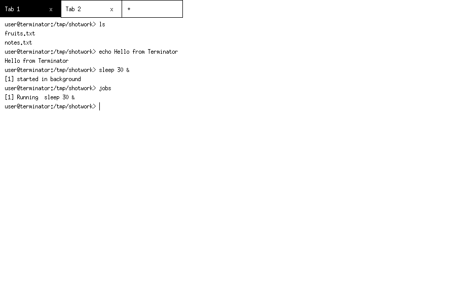

# Terminator — a custom terminal emulator and shell

**CS69201 Computing Lab · Term Project · IIT Kharagpur**

Terminator is a terminal emulator *and* a shell, written in C for Linux.
It draws its own X11 window with multiple tabs and runs commands with
pipes, redirection, job control, searchable shared history, file-name
completion, configurable hotkeys, a parallel `multiWatch` command, and
its own bash-script interpreter — no part of a command is ever handed to
`/bin/bash` or `/bin/sh`.



## Dependencies

- A C compiler (`gcc`) and `make`
- X11 development headers: **libx11-dev**
- An X server to run against (a real desktop, or Xvfb for headless use)

Install on Debian/Ubuntu:

```sh
sudo apt-get install build-essential libx11-dev
```

## Build

```sh
make            # produces ./terminator
make clean      # remove the binary
make test       # build, then run the automated test suite
```

## Run

```sh
./terminator                  # thread mode (default)
./terminator useProcess=True  # process mode
```

A first session looks like this:

```
user@terminator:~> ls
fruits.txt
user@terminator:~> sleep 30 &
[1] started in background
user@terminator:~> jobs
[1] Running  sleep 30 &
```

Both modes look and behave the same:

|                | Thread mode (default)                                   | Process mode (`useProcess=True`) |
|----------------|----------------------------------------------------------|----------------------------------|
| Tab execution  | One worker **thread** per tab inside one process        | One **forked process** per tab; the GUI is the parent |
| GUI ↔ tab      | Shared memory in-process (mutex-protected screen buffer) | Framed packets over pipes           |
| Shared history | Heap list guarded by a `pthread_mutex`                   | History ring in `mmap(MAP_SHARED)` memory, guarded by a **process-shared semaphore** (`sem_init(..., pshared=1, ...)`) |
| Tab crash      | —                                                        | Closing or killing one tab process never affects the GUI or the other tabs |
| Per-tab state  | Each tab has its own cwd, job table and `$?` in all modes; variables live in the process environment, so in thread mode they are shared by tabs (see Known limitations) | same |

## Features

- **X11 GUI with tabs** (Task 1) — own window via Xlib; tabs opened with
  Ctrl+T, the `+` button or a `new_tab` binding; closed with the `x`
  button, Ctrl+Shift+W, `exit` or Ctrl+D; switched by clicking the tab
  bar or Ctrl+Tab / Ctrl+Shift+Tab. Per-tab scrollback buffer; the event
  loop sleeps in `poll()` over the X connection and tab pipes — it never
  busy-waits. The prompt shows the tab's directory,
  `user@terminator:~/projects> ` (`~` for `$HOME`). Scroll with
  Shift+PageUp / Shift+PageDown or the mouse wheel; typing or new
  output snaps back to the tail.
- **Commands** (Task 2) — external commands via `fork()` + `execvp()` +
  `waitpid()`; built-ins `cd`, `exit`, `history`, `multiWatch`, `jobs`,
  `fg`, `bg`, `source` (plus `clear`, `pwd`, `export`, `unset`). The last
  exit status is kept in `$?`. An unknown command prints
  `terminator: <cmd>: command not found` and the tab stays usable.
- **Multiline input & quoting** (Task 3) — trailing `\` continuation and
  unclosed quotes/`$(...)`/backticks show the `> ` continuation prompt;
  single quotes are literal; double quotes still expand `$VAR` and
  substitutions; `$(...)` and `` `...` `` substitution is supported,
  nested (innermost first) and multi-line, and is evaluated by
  Terminator's own engine. Backslash escapes work (`\$`, `\\`, `\"`);
  `~` expands at word starts; `$((…))` arithmetic and `#` comments work;
  `cmd1 && cmd2`, `cmd1 || cmd2` and `cmd1; cmd2` chains work with
  short-circuiting; `NAME=value cmd` sets the variable for that command
  only; `cd -` returns to the previous directory. Heredocs work in
  multi-line form (`cat <<EOF` … `EOF` on its own line; quoted
  delimiter keeps the body literal).
- **Redirection** (Task 4) — `<`, `>` (and `>>`) via `dup2()` in the
  child, plus fd forms (`2>`, `2>>`, `2>&1`, `&>`, `&>>`, `|&`);
  redirections apply in order, so `>f 2>&1` and `2>&1 >f` differ as
  in bash. A missing input file is reported, the command is not run,
  and the status is 1. Built-ins honour output redirection too
  (`history > file`).
- **Pipes** (Task 5) — pipelines of any length (N commands, N−1 pipes),
  combinable with redirection; a whole pipeline is one process group.
- **multiWatch** (Task 6) —
  `multiWatch ["date +%T", "ls | wc -l"]` runs all commands in parallel,
  one pipe per command, serviced with `poll()`; each round re-runs 2 s
  after the round started. A watched command may itself be a `;` /
  `&&` / `||` list (`multiWatch ["sleep 1; echo A"]`) whose parts run
  in order under one header. Every block is printed exactly as:

  ```
  "date +%T", 1790860020:
  ----------------------------------------------------
  18:37:00
  ----------------------------------------------------
  ```

  Ctrl+C kills every watched pipeline and the shell keeps running.
- **Hotkeys** (Task 7) — ←/→ cursor movement, Ctrl+A/E, ↑/↓ history,
  Ctrl+U/K, Ctrl+W, Ctrl+L, Ctrl+D (closes the tab whenever it is
  idle, even with text typed but not executed), Ctrl+Shift+C/V
  copy/paste via X11 selections — Ctrl+Shift+C copies a mouse-drag
  selection when one exists, otherwise the input line; pasting keeps
  newlines (several pasted lines run one by one when submitted, and a
  paste ending in a newline submits at once); plus Ctrl+C /
  Ctrl+Z for jobs, and Shift+PageUp / Shift+PageDown for scrolling.
  **All** bindings can be changed in
  `~/.terminatorrc` without recompiling and persist across
  restarts; invalid or conflicting bindings are reported at startup and
  the default is kept. See `terminatorrc.sample`.
- **Signals & job control** (Task 8) — Ctrl+C sends `SIGINT` and Ctrl+Z
  sends `SIGTSTP` to the foreground job's process group via `kill()`;
  `cmd &` backgrounds a job; `jobs`, `fg %n`, `bg %n` manage it.
  Terminator itself ignores SIGINT/SIGTSTP and never stops.
- **Searchable history** (Task 9) — the last 10,000 commands are kept in
  `~/.terminator_history`, shared by all tabs in both modes; `history`
  shows the most recent 1,000. Ctrl+R prompts `Enter search term:` and
  prints the most recent exact match, otherwise the command(s) with the
  longest common substring with the term (if longer than 2 characters),
  otherwise `No match for search term in history`.
- **Tab completion** (Task 10) — completes file names in the tab's cwd:
  one match completes it; several matches extend to their longest
  common prefix and then show a numbered list to pick from; no match
  does nothing. The rest of the line is preserved.
- **Bash scripts** (Task 11) — `./script.sh`, `bash script.sh` and
  `source script.sh` are interpreted by Terminator itself: comments,
  variables, `$1`…`$9`, `$#`, `$?`, `$0`, pipes, redirection, heredocs,
  substitution, nested `if`/`elif`/`else`/`fi` with `[ ]` tests
  (`-eq -ne -gt -ge -lt -le = != -f -d -e -z -n`), and `exit [n]`.
  Scripts are validated before they run: a syntax error such as a
  missing `fi` is reported and nothing is executed.

## Headless test harness

```sh
./terminator --batch < commands.txt
```

`--batch` runs the same shell engine without X11: command lines on
stdin, output on stdout. It exists for the automated suites in `tests/`
and is handy for scripting demos.

## Testing

| Suite | Command | Result |
|---|---|---|
| Shell engine, scripts, history, redirections | `bash tests/run_tests.sh` (or `make test`) | 143 checks pass |
| Hotkey configuration | `bash tests/config_test.sh` | 9 checks pass |
| Real window, thread mode | `bash tests/gui/run_gui_tests.sh thread` | 34 checks pass |
| Real window, process mode | `bash tests/gui/run_gui_tests.sh process useProcess=True` | 36 checks pass |
| Mouse tab switching | `bash tests/gui/mouse_test.sh <mode>` | 5 checks pass in each mode |
| Line-editor boundaries | `bash tests/gui/edge_test.sh <mode>` | 10 checks pass in each mode |

The GUI suites drive the real window under Xvfb with synthetic key and
mouse events and assert on side-effect files. Behaviour was also
checked against bash with a differential suite (same commands through
bash and `--batch`); the only remaining differences are two accepted
ones listed in `docs/DESIGN.md` §11. Design diagrams and screenshots
are in `docs/DESIGN.md`.

## Repository layout

```
src/               one C file per stage (GUI + shell engine +
                   interpreters), split only so each stage can be
                   explained on its own for viva walkthroughs:
                   main.c, screen.c, tabs.c, history.c, executor.c,
                   shell.c, jobs.c, multiwatch.c, config.c, editor.c,
                   script.c, batch.c, util.c, plus common.h with the
                   shared declarations; same functions and behaviour
                   as the single-file version, see docs/DESIGN.md
Makefile           make -> ./terminator  (-lX11 -lpthread -lrt)
docs/DESIGN.md     design document
terminatorrc.sample  sample ~/.terminatorrc
tests/             check.sh (spec example), demo.sh, bad.sh, script2.sh,
                   cwdtest.sh, hdscript.sh, run_tests.sh, config_test.sh,
                   gui/ (window tests under Xvfb, with keys/shot senders)
```

## Known limitations

- No PTY: interactive full-screen programs (`vim`, `top`, ssh
  password prompts) do not work, and typing in the window does not
  feed stdin to a running command (in process mode a command's
  stdin is `/dev/null`).
- Script variables and `$1`…`$#` are stored in the process environment
  (inherited from the original design), so they are shared by the tabs
  of a process in thread mode; cwd and jobs are strictly per-tab.
- History entries longer than 511 characters are truncated in the
  shared-memory ring used by process mode (the history file keeps the
  full line in thread mode).
- `history` numbering and Ctrl+R operate on the shared history; the
  per-tab ↑/↓ browsing position is per tab, as in bash.
- One command line is at most 4095 characters; a pipeline at most 32
  commands; at most 20 tabs.
- Deliberate bash divergences (see `docs/DESIGN.md` §11): no `!`
  history expansion or brace expansion; no `[[ ]]`, loops, functions
  or process substitution; at most one heredoc per command, none
  inside `$(...)` or multiWatch.
