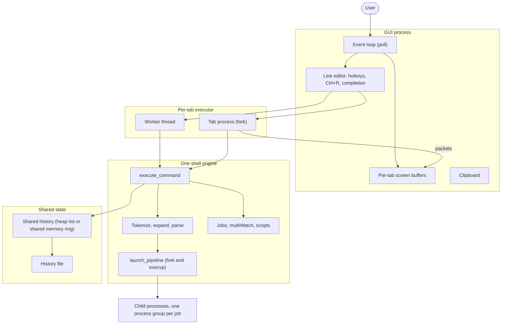
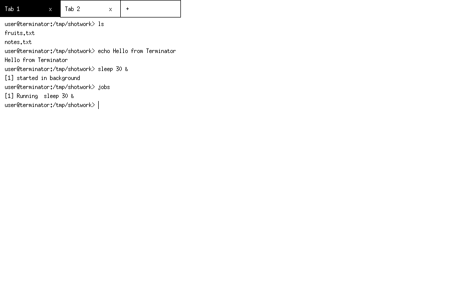
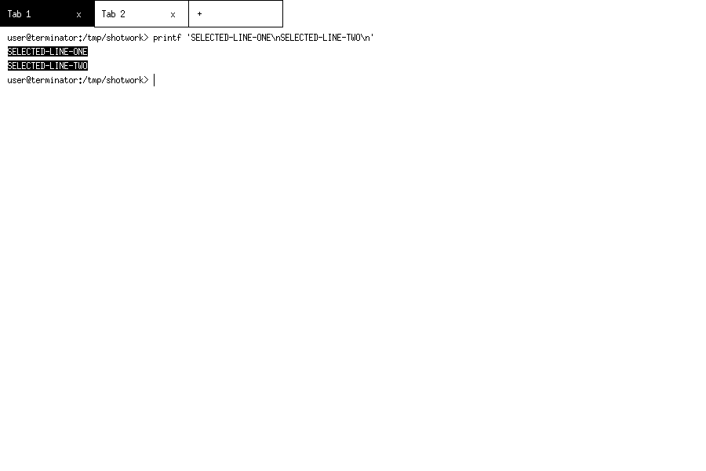
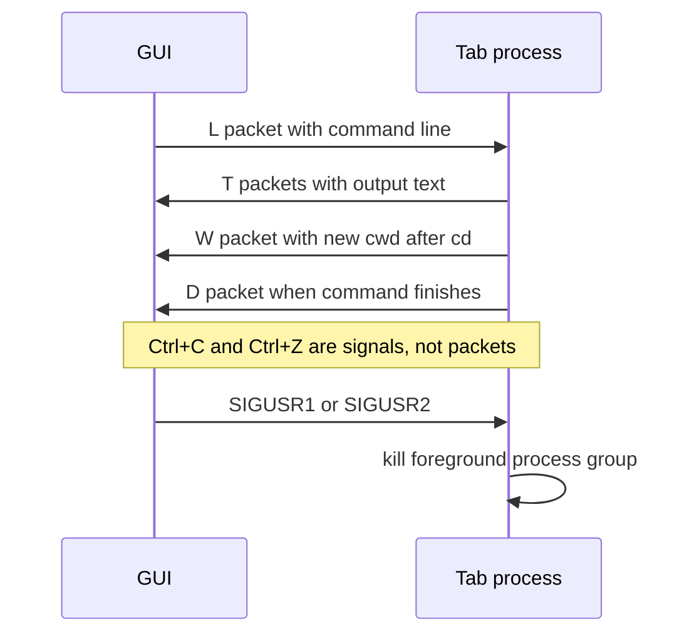
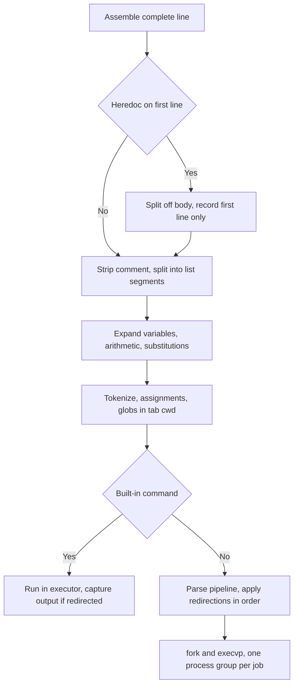
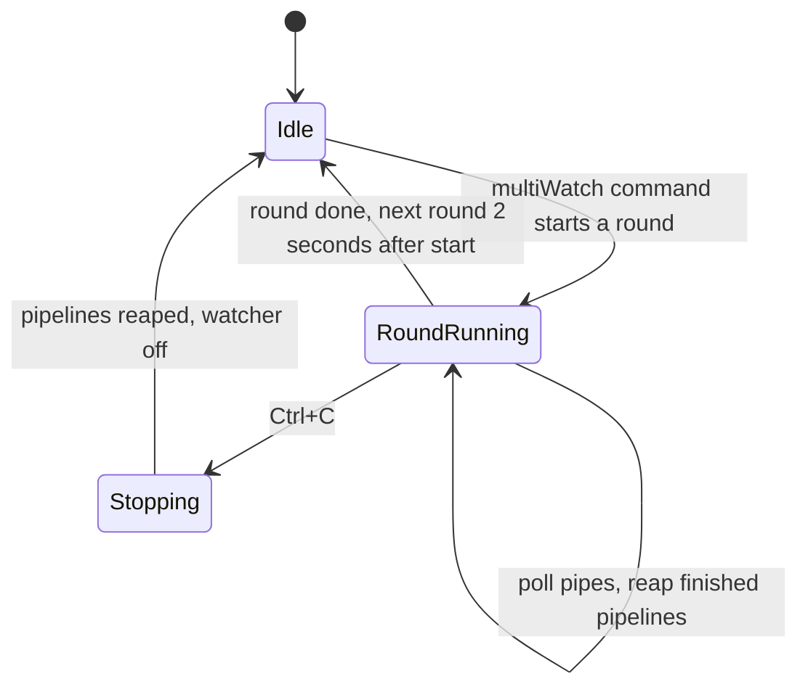
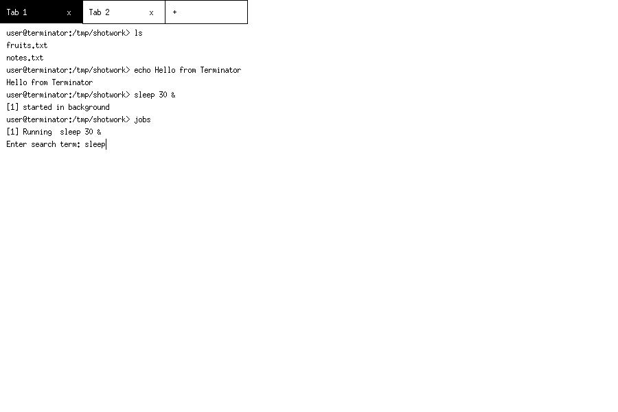

# Terminator — Design Document

CS69201 Computing Lab · Term Project

This document describes the architecture of Terminator as implemented
in `src/` — one C file per stage (plus `common.h`), together both an
X11 terminal emulator and a shell. The split is mechanical: every
function keeps its name, signature and body; only `static` was dropped
where a function or global is used in another file, and the shared
declarations moved to `common.h`. The design keeps the structure of
the original code (one `Tab` array, one shell engine built around
`tokenize` → `parse_commands` → `launch_pipeline`) and completes it
with a per-tab executor model that makes the two required execution
modes real.

File layout (counts include each file's banner comment and the shared
declarations in `common.h`):

| File | Sections | What lives there |
|---|---|---|
| `src/main.c` (194) | §1–2 | entry point, X11 setup, event loop, clipboard, mouse wheel + selection |
| `src/screen.c` (479) | §2 | screen buffer, drawing, line wrapping, tab expansion, scrolling, prompt, mouse selection |
| `src/tabs.c` (85) | §2 | tab slots: create, close, look up |
| `src/history.c` (165) | §3 | shared history: heap list / shared-memory ring / file |
| `src/executor.c` (142) | §3 | worker thread, tab process, packets |
| `src/shell.c` (1414) | §4 | the shell engine: parsing, pipelines, built-ins |
| `src/jobs.c` (171) | §5 | job table, reaping, Ctrl+C / Ctrl+Z, waiting |
| `src/multiwatch.c` (260) | §6 | multiWatch state machine |
| `src/config.c` (108) | §7 | hotkeys and `~/.terminatorrc` |
| `src/editor.c` (387) | §7–8 | line editor, history browsing, Ctrl+R, completion |
| `src/script.c` (236) | §9 | script interpreter and `[ ]` tests |
| `src/batch.c` (45) | §10 | headless `--batch` harness |
| `src/util.c` (38) | — | path join, sleep, packet read/write helpers |
| `src/common.h` (266) | — | includes, types, shared globals, prototypes |

## 1. Overview

```
            +------------------------- GUI process -------------------------+
            |  X11 event loop (poll on X fd + tab pipes)                    |
            |  draw_screen() from per-tab screen buffers                    |
            |  handle_key(): line editor, hotkeys, Ctrl+R, completion     |
            +------+----------------------------+---------------------------+
                   | thread mode                  | process mode
                   | queue_line + has_submit      | framed packets on pipes
                   v                              v
            per-tab executor:  execute_command() — THE shell engine
                   tokenize · expand $VAR/$? · $(...)/`...` · built-ins
                   pipelines · redirection · jobs · multiWatch · scripts
                   |
                   v
            child processes via fork/execvp, one process group per job
```

The same structure as a diagram (GitHub renders Mermaid diagrams
directly in the document):



There is exactly **one shell engine**, `execute_command(Tab *, line)`.
The GUI line editor assembles a complete command (joining continuation
lines), the batch harness feeds lines from stdin, scripts feed lines
from a file, and all three paths end at the same engine. The engine
never knows where its line came from or where its output goes:
everything it prints goes through `append_text`/`append_screen`, which
route to the tab's screen buffer (GUI modes), to a framed packet pipe
(process mode, inside the tab process), to a capture file (redirected
built-ins), or to stdout (`--batch`).

The window itself, running with two tabs open:



## 2. X11 GUI and event loop (Task 1)

- The window is created with `XOpenDisplay`, `XCreateSimpleWindow`,
  `XCreateGC` and the core `fixed` font; text is drawn with
  `XDrawString`. The tab bar shows `Tab 1`, `Tab 2`, … per tab plus `x` (close)
  and `+` (new) affordances and is fully mouse-driven
  (`ButtonPress` → hit-test against tab rectangles).
- The screen is a *drawing of a buffer*: each tab owns a 16 KB
  scrollback (`Tab.screen`). Keys and command output only mutate the
  buffer; `draw_screen()` re-renders the visible tail of the buffer,
  the tab bar, the prompt (`user@terminator:<dir>> ` with `$HOME`
  shortened to `~`, or `> ` during continuation) and the input line
  with a caret at `cursor_pos`. The prompt is rebuilt from the tab's
  current directory on every draw (`build_prompt`), so `cd` in any
  mode is reflected at once. Long lines wrap: `draw_screen()`
  recomputes `wrap_cols` from the window width on every draw and
  paints each logical line as fixed-width segments, so resizing
  re-wraps instead of clipping; wrapping is display-only and the
  caret lands on the correct segment. Tab characters are expanded to
  spaces at 8-column stops before drawing, because `XDrawString`
  draws a tab with no visible gap. A `screen_dirty` flag set by
  `append_screen` avoids redundant redraws.
- Scrolling: each tab keeps a `scroll_offset` (rows scrolled up from
  the tail). Shift+PageUp / Shift+PageDown scroll one page and the
  mouse wheel scrolls three rows (`ButtonPress` 4/5 in the event
  loop); the offset is clamped against the current content and window
  size, the caret is hidden while scrolled, any other key or new
  output snaps back to the tail, and the offset is per-tab so it
  survives tab switches.
- Mouse text selection: dragging with Button1 in the text area
  selects output (and the prompt/input line) in the same wrapped
  layout that is drawn, shown inverted; the selection is stored as
  two (segment row, column) endpoints plus the screen generation and
  wrap width it was made against (`screen_gen`, bumped on every
  append/clear), so new output, a clear, or a resize discards it,
  and typing clears it. Ctrl+Shift+C copies the selection
  (falling back to the input line when there is none); pasting keeps
  newlines, so several pasted lines run one by one when submitted,
  and a paste ending in a newline submits at once, as in a real
  terminal (a search term is the exception: newlines paste as spaces).

  
- The main loop never busy-waits: it `poll()`s the X connection fd plus,
  in process mode, every tab process's reply pipe (50 ms timeout), then
  drains `XPending` events and any ready packets.
- Tabs are **slots**, not a compacted array: `tabs[MAX_TABS]` entries
  carry an `active` flag, so a tab's identity (its worker thread, child
  PID, job table, multiWatch slot) is stable for its whole lifetime;
  closing a tab just releases its slot.
- Only the GUI thread ever calls Xlib. In thread mode this is a hard
  rule (workers never touch X); copy/paste is implemented with the
  CLIPBOARD selection (`XSetSelectionOwner`, `SelectionRequest`,
  `XConvertSelection`, `SelectionNotify`) entirely on the GUI thread.

## 3. Execution modes and shared state (§2)

### Thread mode (default)

Each tab gets a **worker thread** (`pthread_create`) running
`tab_worker_main`. The GUI submits a completed line by copying it into
`Tab.queue_line` and raising `has_submit`; the worker runs
`execute_command` and then `wait_for_idle` (drain the command's output
pipe, reap children, service multiWatch and background jobs for that
tab). Shared state and its protection:

| Shared state | Protection |
|---|---|
| Tab screen buffers | `screen_lock` mutex around `append_screen` and `draw_screen` |
| Shared history (heap list) | `history_mutex` |
| Job table / multiWatch of a tab | owned by the tab's worker; GUI touches it only to *stop* things (Ctrl+C/Z), serialised by `state_lock` for table operations |
| Tab cwd, variables, last status | executor-only |

A tab's `cd` changes only its own `Tab.cwd` string — the process never
calls `chdir` except inside a forked child just before `execvp`, so
thread-mode tabs cannot leak working directories into each other.

### Process mode (`useProcess=True`)

At tab creation the GUI `fork()`s a **tab process**. Before the first
fork it creates the shared history segment (below). The child closes
its copy of the X connection, reinitialises its own tab slot, and runs
`tab_child_main`: a loop that polls a command pipe, executes lines with
the same engine, and streams results back. GUI and tab process exchange
**framed packets** (1 type byte + uint32 length + payload):

- GUI → tab: `'L'` a complete command line, `'S'` shutdown.
- Tab → GUI: `'T'` output text (every `append_screen` in the child),
  `'W'` new cwd (so the GUI's prompt, tab label and completion follow
  `cd`), `'D'` command finished, `'L'` clear screen.

Ctrl+C / Ctrl+Z are *not* packets: the GUI sends the tab process
`SIGUSR1` / `SIGUSR2`; handlers in the child only set a flag, and the
child's wait loop translates the flag into `kill(-pgid, SIGINT)` /
`kill(-pgid, SIGTSTP)` on its own foreground job — the same code path
as the GUI modes. This keeps signal delivery responsive even while a
command runs, because the child's drain loop polls with a short
timeout.



If a tab process exits (`exit` builtin) or is killed (`kill -9`), the
GUI sees EOF on the reply pipe, closes just that tab, and keeps
running; other tab processes are independent children and are
unaffected. Closing a tab from the GUI sends SIGTERM to its process
and reaps it. The forked child closes only *active* tabs' pipe ends:
never-created tab slots are zero-filled, so closing their `cmd_fd`
would close the child's stdin (fd 0) and break every pipe, redirection
and heredoc in process mode. Command children also open `/dev/null`
onto any closed standard fd before `dup2`, so `pipe()`/`open()` can
never return 0, 1 or 2.

### Shared history synchronisation

History is accessed only through `hist_add` / `hist_count` / `hist_get`,
which hide two backends behind one lock abstraction
(`hist_lock`/`hist_unlock`):

- **Thread/batch mode:** a growable array of strings (the original
  design), loaded lazily from `~/.terminator_history`, guarded by a
  `pthread_mutex`.
- **Process mode:** a ring of 10,000 fixed 512-byte entries living in an
  `mmap(NULL, ..., MAP_SHARED | MAP_ANONYMOUS)` segment created by the
  GUI *before* forking (children inherit the mapping). The lock is a
  `sem_t` stored in the same segment, initialised with
  `sem_init(&sem, 1 /* pshared */, 1)`. This is exactly the
  shared-memory-plus-process-shared-semaphore design the lecture notes
  prescribe for the lost-update race: appending to history is
  read-count → write-entry → update-count, and doing those three steps
  without the semaphore lets two tabs overwrite each other's slot.

Every add also appends the line to `~/.terminator_history` under an
`flock`, so history survives restarts; consecutive duplicates are
suppressed.

## 4. The shell engine

`execute_command(Tab *, line)`:

1. If the line opens a heredoc (`<<DELIM` on the first line), split
   off the body (lines up to the exact delimiter line) and record
   only the first line in shared history, so body lines never become
   history entries. A missing delimiter, body on the same line, or a
   second heredoc is a syntax error (status 2). The body is expanded
   only when the delimiter was unquoted; a quoted delimiter keeps it
   literal. Heredocs are limited to one per command, on the first
   command of a pipeline, with no `<` input redirection, and are not
   supported inside `$(...)`, multiWatch or `if` conditions.
2. Strip a `#` comment (unquoted, at a word start) from the first
   line, then split the line into a *list* on `;`, newline, `&`,
   `&&`, `||` (respecting quotes, `$(...)`, backticks and escapes)
   and run each segment with short-circuiting: `&&` runs only after
   status 0, `||` only after non-zero. Each segment is expanded
   separately, so `X=1 && echo $X` sees the new value.
3. Per segment: `expand_variables` — quote-aware `$VAR`, `${VAR}`,
   `${VAR-word}`, `${VAR:-word}`, `${VAR+word}`, `${VAR:+word}`,
   `${VAR=word}`, `${VAR:=word}` (the word is itself expanded; `=`
   forms assign it), `$?`, `$#`, `$1`…`$9`, `$0`, `$@`/`$*`, `$$`, tilde at word starts
   (`~`, `~/…`, `~user/…`), and backslash escapes (`\$` does not
   expand; single quotes suppress expansion). Then
   `expand_arithmetic` (`$((…))`, `+ - * / %`, parentheses, unary
   minus, variables, hex), then `expand_substitutions` — finds an
   *innermost* `$(...)` or a `` `...` `` pair (skipping
   single-quoted regions), recursively expands the other form inside
   it, and runs it with `run_capture_sync`, which parses and executes
   it **with Terminator's own `launch_pipeline`** and captures the
   pipe output. No `/bin/sh` exists anywhere in the program
   (verifiable with `grep`): scripts, substitutions and multiWatch
   sub-commands all run through the same machinery as typed
   commands.
4. Bracket-form `multiWatch [...]` is recognised on the raw line
   (before tokenising would mangle `[`, `]`, `,`), then `tokenize`
   (quote/backslash rules; the tokenizer records per-word flags so
   quoted or escaped words are never glob-expanded and never treated
   as assignments), leading `NAME=value` assignments (stripped, set
   in the environment, restored after a pipeline so they do not
   persist — a pure-assignment line sets them permanently), glob
   expansion relative to the tab's cwd (`.`/`..` results dropped),
   and dispatch:
   - built-ins (below), with optional output capture for
     `builtin > file`;
   - otherwise `parse_commands` splits the pipeline into `Command`
     structs (argv + an *ordered* redirection list) and
     `launch_pipeline` executes it, optionally transferring it to
     the job table for `&`.



### Built-ins

`cd exit history multiWatch jobs fg bg source` (required) plus
`clear pwd export unset`. They run inside the tab's executor precisely
because they mutate executor state: `cd` rewrites `Tab.cwd` (and
`Tab.prev_cwd`, so `cd -` returns to the previous directory and prints
it; a failed `cd` reports `cd: <path>: <reason>` and sets status 1);
`fg`/`bg` with no argument act on the most recent job; bare `export`
lists `declare -x NAME="value"` lines; `fg` re-attaches a job's
pids/out_fd/pgid to the tab and marks it running (its executor's
`wait_for_idle` then finishes the wait); `source` runs the script
interpreter in-process.

### Pipelines and redirection (Tasks 4–5)

`launch_pipeline_fds` is the single place processes are created:
N commands → N−1 anonymous pipes plus one output pipe whose read end
is non-blocking. Each child: `setpgid` into the pipeline's process
group, `chdir(Tab.cwd)`, resets SIGINT/SIGTSTP/SIGQUIT/SIGPIPE to
`SIG_DFL` (the GUI ignores them; jobs must not), `dup2` pipe ends onto
stdin/stdout, `dup2` the output pipe onto stderr, then applies the
command's redirections **in order** (`<`, `>`, `>>`, `N<`, `N>`,
`N>>`, `N>&M`, `N>&-`, `&>file`, `&>>file`; `|&` duplicates stderr
into the pipe instead), so `>f 2>&1` and `2>&1 >f` differ exactly as
in bash. A heredoc command gets its body through a pipe written
before the fork. A failed redirection open reports the error and the
child `_exit(1)`s *before* `execvp` (status 1, as in bash; 126 is
reserved for non-ENOENT exec failures), so the command never runs.
An `ENOENT` from `execvp` prints `terminator: <cmd>: command not
found` and exits 127. A line with only redirections (`> file`)
creates/truncates the file and returns status 0/1 without forking.
`launch_pipeline` (the interactive wrapper) stores the resulting
fd/pid set on the tab.

## 5. Process and job management (Task 8)

Each tab owns a **job table** (`Tab.jobs[64]`, ids from
`Tab.next_job_id`). A job is a pipeline's process group plus its pid
list, output fd and state. Transitions:

- `cmd &` — launch, `add_job(stopped=0)`, tab returns to the prompt
  immediately; `refresh_jobs` (run by the executor) forwards the job's
  output to the tab buffer and reaps with
  `waitpid(WNOHANG|WUNTRACED|WCONTINUED)`, tracking Stopped/Running.
- Ctrl+Z (GUI event or SIGUSR2 in a tab process) — `kill(-pgid,
  SIGTSTP)`, then the foreground pipeline is *adopted* by the job
  table (`add_job(stopped=1)`) and the tab stops waiting for it.
- `bg %n` — `kill(-pgid, SIGCONT)`, mark Running, do not wait.
- `fg %n` — `kill(-pgid, SIGCONT)`, move the job's pids/fd back onto
  the tab as its foreground pipeline; the executor's normal wait path
  collects the final status into `$?`.
- Ctrl+C — `kill(-pgid, SIGINT)` (with per-pid fallback). Terminator
  itself cannot be stopped this way: the GUI process ignores
  SIGINT/SIGTSTP, signals are only ever sent to job process groups
  (never to 0 or to its own group), and every pipeline lives in its
  own group created with `setpgid`.

`$?` is per tab (`Tab.last_status`), updated by the reaper from the
last pipeline stage (`WEXITSTATUS`, or 128+signal).

## 6. multiWatch (Task 6)

`multiWatch` is an asynchronous per-tab state machine
(`MultiWatch` struct), serviced by the tab's executor — it never
blocks the event loop or the tab. Starting a round launches every
command concurrently through `launch_pipeline_fds` (one output pipe
per command, i.e. per *pipeline*).



Servicing polls the pipes by
reading whatever is available (non-blocking fds), reaps finished
pipelines, and re-arms the next round for **2 s after the round
started** (schedule kept with a monotonic clock; missed slots are
skipped, not caught up).

Output format is exact: when a command's first output arrives (or it
finishes silently), the header `"cmd", <unix_timestamp>:` and a
52-hyphen line are written, then the raw output, then a closing
52-hyphen line (with a newline inserted first if the output did not
end with one). Ctrl+C sets `stopping` and sends SIGINT to each
watched pipeline's process group; the state machine winds down and
the tab (and shell) continue normally. Watched commands are rejected
if they contain a heredoc, which has no stdin to feed them; their
globs are expanded against the tab's cwd before launch. A watched
command may itself be a `;` / `&&` / `||` list (for example
`multiWatch ["sleep 1; echo A"]`): the round launcher splits it once
per round with the same quote/`$(...)`-aware `split_list` as typed
commands and runs its segments one after another under the same
header/footer, with `&&`/`||` short-circuiting on each segment's exit
status (the pipeline's last stage, as in `$?`). Watched commands stay
concurrent with each other; `&` inside a watched command runs
sequentially like `;`. Built-ins and `NAME=value` prefixes are not
supported inside watched commands — they are launched as external
pipelines only.

## 7. Hotkeys and configuration (Task 7)

All twenty-two actions (new/close tab, clear, history search, line
start/end, delete to start/end, delete word, copy, paste, interrupt,
suspend, EOF, history prev/next, cursor left/right, tab next/prev,
scroll up/down) have entries in one binding table
(`bind_mods[]`/`bind_keys[]`).
`handle_key` matches events against the table with
`state & (Control|Shift|Mod1)` compared exactly and letter keysyms
canonicalised to lower case, so Caps/Num Lock bits cannot break
matching and `Ctrl+A` works regardless of how the keysym is cased.

`load_hotkeys` seeds the table with the spec's defaults — scroll up
is Shift+PageUp, scroll down is Shift+PageDown, both remappable
(`scroll_up`, `scroll_down`) — then applies `~/.terminatorrc`. Both `action=Ctrl+L` and `bind Ctrl+L clear-screen`
lines are accepted. Each line is validated: unknown actions and
unparseable combos are reported (`config_warn` → stderr *and* a note
shown in the first tab at startup) and ignored; a combination already
bound to a different action is reported as a conflict and the
requesting action keeps its default. Because the file is re-read at
every start, bindings persist across restarts with no recompiling.

The line editor itself (user's original design, completed) keeps the
input in `Tab.input` with an explicit `cursor_pos`: insertion,
BackSpace/Delete and all Ctrl+letter operations act *at the cursor*,
and the caret is drawn at the cursor position. Every editor operation
is guarded at the boundaries (BackSpace/Delete on an empty line,
Left at the start, Right at the end, Ctrl+U/Ctrl+W at the start,
Ctrl+K at the end, Up/Down at the ends of history): nothing crashes
and nothing is corrupted; the GUI suite `tests/gui/edge_test.sh`
covers all nine cases in both modes.

Ctrl+D (EOF) exits the shell — it closes the tab, or quits on the
last tab — whenever the tab is idle, even when text is typed but not
yet executed (the unexecuted line is discarded, as EOF discards it in
a real shell). While a command runs the tab cannot close, so Ctrl+D
then deletes the character under the cursor instead; the Delete key
always deletes the character under the cursor. Ctrl+Shift+C copies
the mouse selection when one exists, otherwise the input line.
Ctrl+C discards the typed-but-unexecuted line in every mode —
including process mode, where the input lives in the GUI and the
child signal alone cannot clear it — and also flushes input typed
ahead while a command runs. Ctrl+L clears the screen buffer and
redraws the prompt with the current input line kept, as in bash;
Ctrl+U is the key that deletes the line.

## 8. History search and completion (Tasks 9–10)

**Ctrl+R** flips the editor into search mode. While searching, the
live input line itself is drawn with the `Enter search term: `
prompt, so the term being typed shows right after the label; no
label is appended to the screen buffer, and results print on their
own lines.



On Enter, `do_history_search` scans the shared history newest-first
for an **exact** match and prints it; failing that it computes, for
every entry, the longest common substring with the term and prints the
entry/entries achieving the maximum when it is **> 2** characters;
otherwise it prints `No match for search term in history`. The scan is
O(entries × |term| × |entry|) worst-case — acceptable for an
interactive keypress on ≤10,000 short lines. ↑/↓ browsing walks the
same shared list with a per-tab position.

**Completion** (`complete_input`) takes the word ending at the cursor,
builds a glob in the **tab's cwd** (not the process's), and:
- one match → insert it (adding `/` for directories);
- several → extend the word to the matches' longest common prefix,
  then display the numbered list; the next digit keypress (or a fresh
  Tab cycle) selects via `select_completion`;
- none → nothing happens.
Insertion replaces only the word span `[completion_start,
completion_start+completion_prefix_len)`, so the rest of the line —
before and after the cursor — is preserved exactly.

## 9. Script interpreter (Task 11)

`run_script_file` interprets a script itself:

1. **Pre-validation** (`validate_script_structure`): the whole file is
   scanned first for balanced, correctly ordered
   `if/elif/else/fi` (with nesting), skipping heredoc bodies whole
   (a body line reading `if` or `fi` must not disturb the nesting
   check). A script with a missing `fi` (or a stray `else`/`fi`)
   is reported as a syntax error and *nothing in it runs* — status 2.
2. Execution is line-based: comments stripped (quote-aware),
   `NAME=value` assignments applied with `setenv` (after variable
   and arithmetic expansion), heredoc lines consumed raw up to
   their delimiter and executed through the full engine (inactive
   branches discard the body without running it),
   `if/elif/else/fi` tracked on an explicit `IfFrame` stack
   (parent_active / branch_taken / active / saw_else), `exit [n]`
   returns the status, nested `source`/`bash`/`.` recurse with a
   depth cap, and every other line is handed to
   `execute_command_sync` — the full engine, waited for — so script
   lines support built-ins (`cd` affects the rest of the script),
   pipes, redirection and substitution for free. `$0` is the
   script's own path (via `TERMINATOR_ARG_0`).
3. `[ ]` tests (`script_test`) accept the standard prefix form after
   the usual `; then` tail is stripped: file tests `-f -d -e`,
   string tests `-z -n = == !=`, integer tests
   `-eq -ne -gt -ge -lt -le`, single-string truth, and `!` negation.
   Relative paths resolve against the tab's cwd. Operands have
   already been expanded (`$1` arrives via the
   `TERMINATOR_ARG_n` environment entries the interpreter sets from
   the invocation arguments, `$#` via `TERMINATOR_ARGC`, `$?` from
   the tab's last status).
4. Loops and functions are intentionally not implemented (not
   required by the spec).

## 10. --batch mode

`./terminator --batch` is a headless harness around the same engine:
no X connection, executor = the main thread, `append_screen` writes to
stdout, SIGINT is caught and forwarded to the foreground job, and
`multiWatch` is serviced until interrupted. It exists so the engine
can be regression-tested end-to-end (`tests/run_tests.sh`) and so
demos can be scripted.

## 11. Known limitations

- No PTY (see README): interactive stdin-reading programs and
  full-screen applications are out of scope, as in the original code.
- Variables live in the process environment (original design), so in
  thread mode they are process-wide rather than per-tab; cwd, jobs and
  `$?` are per-tab.
- The shared-memory history ring truncates entries at 511 bytes.
- Screen scrollback wraps at 16 KB of text per tab (original design).
- Deliberate divergences from bash, checked against bash with a
  differential suite (a compact 12-case harness covering
  heredoc, escapes, lists, fd redirects, globs, arithmetic, prefix
  assignments, pipes, substitution and tilde/comments):
  no `!` history expansion; no brace expansion `{a,b}`; no `[[ ]]`,
  `case`/`for`/`while`/`select`, functions, process substitution or
  `coproc`; at most one heredoc per command and none inside
  `$(...)`, multiWatch or `if` conditions; heredoc bodies are capped
  at 4096 bytes; multi-digit fd redirects (`10>file`) are not
  recognised; an unclosed quote reports "incomplete input" instead
  of bash's "unexpected EOF" wording (the behaviour — wait for more
  input, then error at EOF — is the same); a failed input redirection
  reports the file error without bash's `bash: line N:` prefix (the
  exit status, 1, is the same); `$0` is `terminator`
  (bash reports `bash` when reading stdin) and `$$` is the
  process's own pid, so those two values inherently differ
  between shells.
